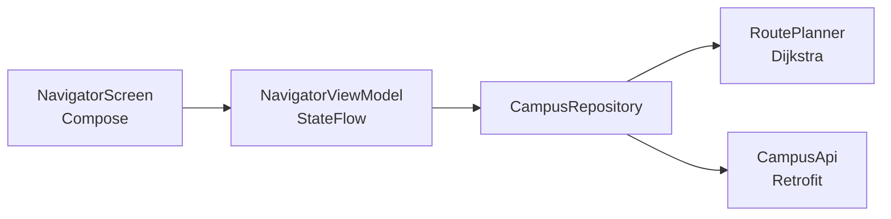

# Campus Navigator (Android)


An Android app that plans walking routes across campus — built with **Kotlin, Jetpack Compose, Retrofit, and coroutines**.

The route planner runs **locally with Dijkstra** over the walkway graph, so the app still works offline; a Retrofit API contract is included for syncing places and routes with a backend.

---

## Features

- Pick start/destination places from dropdowns and get the shortest walking route
- Local Dijkstra planner with a bundled campus graph (no network required)
- Retrofit + OkHttp client for a places/routes backend (bring your own API)
- ViewModel + StateFlow UI state with graceful offline fallback
- Material 3 theming with automatic dark mode

## Architecture



```
app/src/main/java/com/heichan/campusnavigator/
├── MainActivity.kt
├── data/
│   ├── CampusRepository.kt
│   └── remote/            # CampusApi, ApiClient, DTOs
├── domain/
│   └── RoutePlanner.kt    # pure Dijkstra (unit-tested)
└── ui/
    ├── NavigatorScreen.kt
    ├── NavigatorViewModel.kt
    └── theme/Theme.kt
```

## Getting started

1. Open the project in **Android Studio** (Ladybug or newer) and let it sync.
2. Run the `app` configuration on an emulator or device (min SDK 26).
3. To connect a backend, set your API base URL in
   `data/remote/ApiClient.kt` (`BASE_URL`) and implement these endpoints:

| Method | Endpoint | Response |
| --- | --- | --- |
| `GET` | `/places` | `[{id, name, latitude, longitude}]` |
| `GET` | `/route?from=&to=` | `{distance_metres, path: [names]}` |

## Tests

The route planner is pure Kotlin and unit-tested without Android dependencies:

```bash
./gradlew test
```

| Test | Expectation |
| --- | --- |
| Shortest path | `Library → Canteen → Engineering Building` beats the direct 500 m walkway |
| Unreachable place | returns `null` |
| Same place | distance `0` |

## Roadmap

- [ ] Draw the route on Google Maps Compose
- [ ] Sync the walkway graph from the backend on first launch
- [ ] Indoor positioning / QR checkpoints

## Notes

This is a learning-focused Android project. The local planner and UI flow are complete; the backend is intentionally bring-your-own (see the contract above) so the app is not tied to any private service.

## Author

**HeiChan (Chan Hei Lun)** — BEng in Information Engineering, CUHK
[github.com/ChanHei419](https://github.com/ChanHei419)
